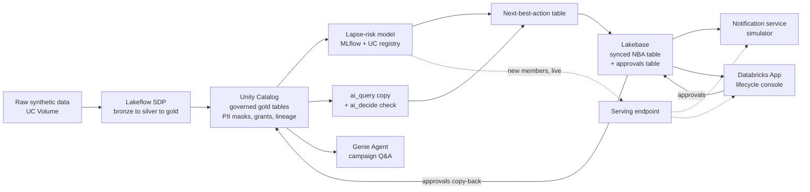

# Hearth Nudges: project context

Context for anyone (human or AI agent) working in this repo. `CLAUDE.md` points here.

## What this is

A working AI prototype for **Hearth**, a fictional dating app, built for the Databricks FE Bar. It solves one customer problem end to end on synthetic data: sending the right re-engagement notification to the right member at the right time, instead of blasting everyone.

**Due 11/30/2026.** Target first submission 11/21, leaving the last week for the live demo and resubmits.

### What the build has to show
- **Six layers, connected in one flow:** Lakeflow ingests, Unity Catalog governs, Lakebase serves, ML/GenAI adds intelligence, a Genie Agent answers questions (a real Genie, not a chatbot in the app), and a Databricks App brings it to the business.
- **A real customer problem**, not an internal one, framed by business outcome before architecture.
- **Proof it ran, as text.** Reviewers read text only, so commit notebook outputs, pipeline logs, metrics and query results. Screenshots don't count.
- **Ingestion built as an SDP pipeline**, not a Job (a Job-only ingestion has failed review as "no build construct").

## The story

**Problem.** Hearth sends the same push notifications to everyone through a third-party messaging tool. Members tire of them, opt out and uninstall. Marketers wait about a minute for every segment query, and segments arrive overnight by reverse ETL, so they're stale before a campaign goes out. Lapsing members get generic nudges at the wrong time, and the ones most likely to come back are missed.

**Solution.** The Databricks Data Intelligence Platform decides for each member **whether to nudge, which nudge, when, and with what words**. It writes that decision straight to an operational store the notification service reads, with no reverse ETL. Marketers review and approve campaigns in a lifecycle console and ask Genie how campaigns are doing in plain English.

**Industry fit.** Digital natives, consumer apps. Next-best-action and retention optimization, with real-time personalization as a secondary fit.

### Audiences for the demo
- **Business stakeholder, VP of Growth / Lifecycle.** Reactivation, retention, paid conversion, cost, time to value.
- **Technical stakeholder, Director of Platform Engineering.** Latency, freshness, how the notification service connects, PII governance, reliability, fit with an in-house platform.

## Architecture

| Layer | What it does in Hearth |
|---|---|
| **Lakeflow (SDP)** | Auto Loader ingests app events, notification decisions and callbacks, members and subscriptions from a UC Volume. Bronze → silver (cleaned, sessionized, funnel) → gold (member daily features, labels, nudge outcomes, campaign KPIs), with expectations for data quality |
| **Unity Catalog** | Schemas in `katie_febar_catalog`, column masks on PII, sensitive-attribute tags, grants for a marketing group, lineage from raw files to the app |
| **ML** | Lapse-risk model (will this member go inactive in the next 7 days), tracked in MLflow and registered in UC. Rules pick the nudge and send hour in phase 1, an uplift model in phase 2 |
| **GenAI** | `ai_query` with Claude Haiku writes the copy. OpenJev via `ai_decide` checks it for PII, tone and policy before it can reach Lakebase. The app's live LLM calls go through the Unity AI Gateway |
| **Lakebase** | Synced next-best-action table (member, nudge, send hour, score, copy) that the notification service reads by member ID, plus an approvals table the app writes to. This replaces reverse ETL |
| **Genie Agent** | Over the gold tables (metric views if time allows). "Which nudges brought back the most members last week?", "Opt-out rate by nudge type", "Lapse risk by cohort" |
| **Databricks App** | Lifecycle console to build or pick a segment, preview the next-action queue, review and approve copy, look up a member live, and watch the KPIs |

## Where things live

| File | What it holds |
|---|---|
| `AGENTS.md` | This file. Goals, architecture, plan, status, conventions |
| `docs/data-design.md` | Synthetic data design, planted patterns, governance |
| `docs/build-log.md` | **The one record of decisions and trade-offs**, plus how AI was used, session by session |
| `README.md` | Written in phase 4. Business outcome first, then architecture, run evidence, decisions and how AI was used |

Decisions are recorded only in `docs/build-log.md`. Don't copy them elsewhere.

Internal details (workspace URL, resource IDs, FE Bar scoring and rules, internal links) are in `CLAUDE.local.md`, which is gitignored. Never move them into a committed file.

## ML approach

| Phase | Lapse model | Nudge picker |
|---|---|---|
| **1 (enough to pass)** | Classifier for inactive in the next 7 days | Rules on lapse risk, eligibility and past response by segment |
| **2 (for Exceeds)** | Same | **Uplift model** estimating how much each nudge raises the chance of return compared with no send, trained on the randomized arms and holdout. Only the picker step changes |

## KPIs and value

**KPIs.** Reactivation rate of lapsing members, opt-out and uninstall rate, notifications per active member (fewer, better), paid conversion of returners, marketer time to segment (about 60 seconds down to near instant).

**Value math (fill in during phase 4, label as estimates)**
- Monthly active members × lapse rate × lift in reactivation × ARPU × months retained = retained revenue
- Opt-outs avoided × lifetime value of a reachable member = protected reach
- Retired reverse ETL and vendor messaging costs = platform savings

**Trade-offs the README must explain**
- Lakebase vs a cache for serving the next action
- Batch scoring into Lakebase vs calling the endpoint live at send time
- SDP vs Jobs for the pipeline
- Rules vs an uplift model for picking the nudge
- `ai_query` batch copy vs generating copy live in the app
- Synced table vs writing to Lakebase directly

## Ways to reach Exceeds
- Uplift model (phase 2)
- Copy judge with OpenJev, plus an MLflow eval
- Optional cost test of an open-weight model against Haiku, both scored by the judge
- Metric views behind Genie for governed KPI definitions
- AI/BI dashboard for campaign performance
- Strong decisions and "how I used AI" sections in the README

## Plan and status

### Phase 0, setup ✅ (10/26)
- [x] Workspace, Lakebase project and public repo created
- [x] Workspace extended to 12/9 so it stays up for the live demo
- [x] AI Decide preview enabled; OpenJev, `ai_decide` and the Unity AI Gateway tested
- [ ] Request the Lakebase `CREATE CATALOG` grant at the start of the Lakebase sync work (grant lasts only 1 to 5 days)
- [ ] Check the Data Engineering certification is still current

### Phase 1, data, pipeline and governance (10/27 to 11/2)
- [x] Draft the synthetic data design (`docs/data-design.md`)
- [x] Answer the open questions in the data design
- [x] Bundle skeleton (`databricks.yml`, target using the `fevm-katie-febar` profile)
- [ ] Synthetic data generator writing daily files to the UC Volume
- [ ] SDP pipeline bronze → silver → gold with expectations
- [ ] UC setup: schemas, PII masks, tags, grants (`hearth_marketing` and `hearth_pii_readers` account groups already exist)
- [x] Pre-commit check for workspace URLs, tokens and real names
- [ ] Commit pipeline run outputs as text

### Phase 2, intelligence and serving (11/3 to 11/9)
- [ ] Feature table and lapse label
- [ ] Train, track and register the lapse model
- [ ] Serving endpoint for live scoring, batch scoring step
- [ ] Rules-based nudge and send-hour picker
- [ ] `ai_query` copy generation and `ai_decide` copy check
- [ ] Next-best-action table synced to Lakebase
- [ ] Notification service simulator with latency output
- [ ] Commit training metrics, scoring output and sample copy as text

### Phase 3, Genie and app (11/10 to 11/16)
- [ ] Genie Agent over the gold tables with instructions and sample questions
- [ ] Lifecycle console (segments, next-action queue, copy review and approval, member lookup, KPIs)
- [ ] Approvals written to Lakebase and copied back to Delta
- [ ] Full test run from raw files to the app

### Phase 4, narrative, evidence and first submit (11/17 to 11/23)
- [ ] README
- [ ] Deck (PDF)
- [ ] Submission answers: business challenge, how Databricks addresses it, AI tools and trade-offs, outcomes and impact
- [ ] Move `CLAUDE.local.md` out of the folder before picking it in the submission form
- [ ] First submission by about 11/21

### Phase 5, demo and resubmits (11/24 to 11/30)
- [ ] Rehearse tell-show-tell with the deck open, and show the whole build, not just the app and Genie
- [ ] Practice the objections below
- [ ] Run the live roleplay, read the feedback, resubmit as needed

### Objections to prepare for
**Business.** What does it cost to run and when does it pay back? How fast do we get value and what changes on our side? What if the model sends the wrong nudge, or too many? How do we know it's working (holdout, A/B)?

**Technical.** How does the notification service read the next action, and how fast? How fresh is the data, and what if the pipeline is late? How is PII protected? How is the model monitored and retrained? Why Lakebase over our cache or Postgres? How does this fit the platform we're building in-house?

## Environment

| Thing | Value |
|---|---|
| Workspace | `katie-febar` (AWS, us-west-2, serverless), expires 12/9/2026 |
| CLI profile | `fevm-katie-febar` (never put the workspace URL in the repo) |
| Catalog | `katie_febar_catalog` (no `CREATE CATALOG` on the shared metastore), schemas prefixed `hearth_` |
| Lakebase | Project `hearth-nudges`, branch `dev` |
| SQL warehouse | Serverless Starter Warehouse |
| Copy model | `system.ai.claude-haiku-5-5` |
| Decision model | `system.ai.openjev-qwen35-4b` (via `ai_decide` or the System One API) |

## Conventions

- **Synthetic data and the fictional Hearth brand only.** Never name real companies, customers or people, and never commit workspace URLs, IDs, tokens or real data.
- **Don't use Solution Builder** or anything from it.
- **Commits.** The agent commits with a Conventional Commit message and pushes when a piece of work is done and verified, without asking first. Commits are authored as `kstovall1`. The Databricks git hooks crash on Python 3.15. `~/.zshrc` defaults `python3` to 3.13, so plain `git commit` and `git push` work. After cloning, run `scripts/install-hooks.sh` so commits run `scripts/check_leaks.py`, and keep the real values it blocks in the gitignored `.local/denylist.txt`. Check `gh auth status` shows `kstovall1` before pushing.
- **Log every working session** in `docs/build-log.md`: what changed, decisions and why, and the prompts that shaped the work.
- **Writing style.** Plain, short sentences. No em dashes or en dashes. No hype.
